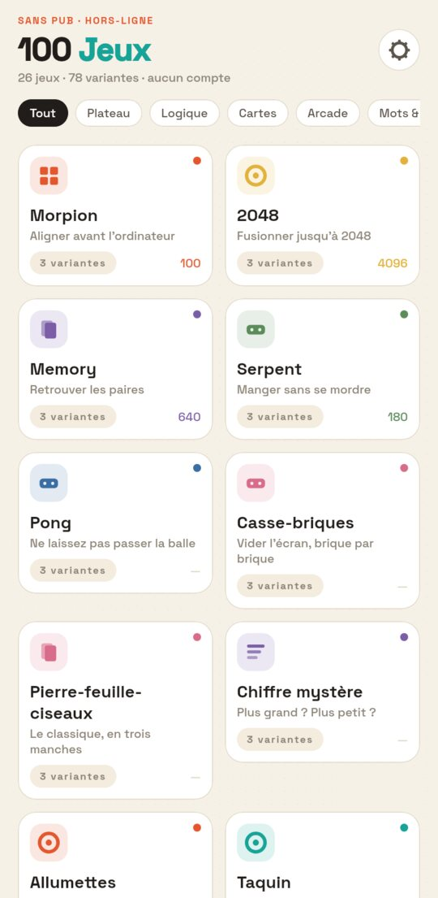
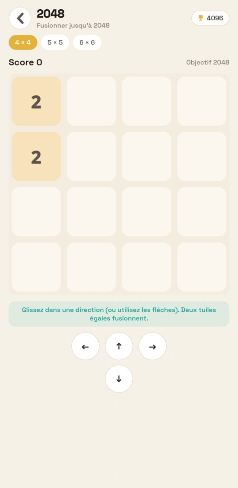
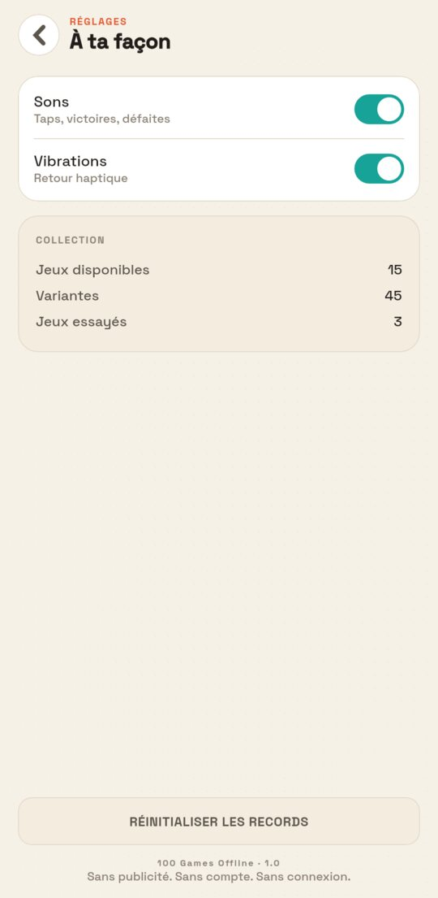

# 100 Games Offline

**Une collection de mini-jeux, gratuite, sans publicité et entièrement hors-ligne.**

Un seul APK, une seule liste : on ouvre, on choisit un jeu, on joue. Pas de
compte, pas de monnaie virtuelle, pas de vidéo publicitaire entre deux parties.

<p align="center">
  
  
  
</p>

## Installer

1. Téléchargez l'APK depuis les [releases](https://github.com/joynix28/100-games-offline/releases/latest).
2. Ouvrez le fichier et autorisez l'installation si Android le demande.

Android 8+. **Aucune permission**, aucun réseau, aucun compte.

## Les jeux

Chaque jeu existe en plusieurs variantes (taille de plateau, difficulté,
vitesse). Le hub affiche automatiquement le nombre de jeux et de variantes.

| Jeu | Variantes |
|---|---|
| Morpion / Gomoku | 3 × 3, 4 × 4, 5 × 5 |
| Puissance 4 | 6 × 7, 7 × 8, 8 × 9 |
| Démineur | Débutant, Intermédiaire, Expert |
| 2048 | 4 × 4, 5 × 5, 6 × 6 |
| Taquin | 3 × 3, 4 × 4, 5 × 5 |
| Memory | 4 × 3, 4 × 4, 5 × 4 |
| Serpent | Tranquille, Rapide, Expert |
| Pong | Cool, Normal, Féroce |
| Casse-briques | Classique, Dense, Rapide |
| Simon | Lent, Moyen, Rapide |
| Calcul mental | Facile, Moyen, Difficile |
| Pendu | Courts, Moyens, Longs |
| Chiffre mystère | 1 à 50, 1 à 100, 1 à 500 |
| Allumettes | 11, 15, 21 |
| Pierre-feuille-ciseaux | 2, 3, 5 manches |
| Dames | Rapide, Classique, Longue |
| Water Sort | Facile, Moyen, Difficile |
| Éteindre les lumières | 3 × 3, 4 × 4, 5 × 5 |
| Sudoku | Facile, Moyen, Difficile |
| Chiffres en ordre | 3 × 3, 4 × 4, 5 × 5 |
| Mots mêlés | Animaux, Voyage, Cuisine |
| Lancer de couteaux | Lent, Normal, Rapide |
| Bulles | Facile, Normal, Difficile |
| Dominos | Double-six, Double-six long, Double-neuf |
| Trois alignés | Détente, Classique, Rapide |
| Couleurs | 8 × 10, 10 × 12, 12 × 14 |

Soit **26 jeux et 78 variantes** dans cette version.

La collection est prévue pour grandir jusqu'à 100 jeux. L'architecture est
faite pour ça : un fichier par jeu, une entrée dans `Catalog.kt`.

## Ajouter un jeu

1. Créer `shared/src/commonMain/kotlin/com/botillon/games/games/MonJeu.kt`.
2. Y déclarer un `GameEntry` (titre, variantes, accent, `Family`).
3. L'ajouter à la liste de `Catalog.entries`.

Le cadre commun (`GameHost`) gère le titre, les variantes, le record et le
panneau de fin. Un jeu n'a donc que sa logique et son plateau à écrire.

## Langue et zoom

Les réglages permettent de choisir **français ou anglais** et la **taille de
l'interface** (petit, normal, grand). Le choix est sauvegardé localement.

## Compiler

```bash
./gradlew :app:assembleRelease     # APK signé
./gradlew :desktop:run             # jouer sur ordinateur
./gradlew :desktop:gallery         # captures d'écran
```

Sans `keys/games.jks`, le build utilise la clé de debug.

| | |
|---|---|
| Langage | Kotlin 2.2 |
| Interface | Compose Multiplatform 1.7.3 |
| Modules | `shared` (jeux + UI), `app` (Android), `desktop` (dev) |
| Dépendances | Compose uniquement |

## Licence

**Apache 2.0** — voir [`LICENSE`](LICENSE) et [`NOTICE`](NOTICE).

> Si vous réutilisez ce code, son design ou son idée, **créditez Joynix** avec un
> lien vers ce dépôt.

Police [Space Grotesk](https://github.com/floriankarsten/space-grotesk) (SIL
OFL 1.1). Sons synthétisés pour le projet.
